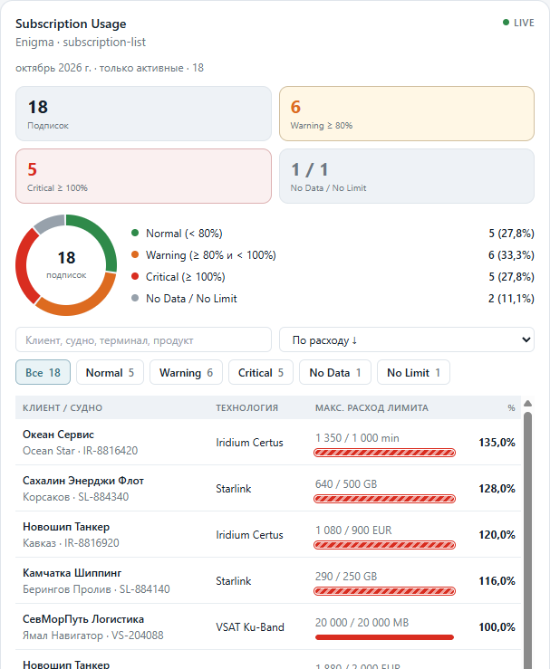
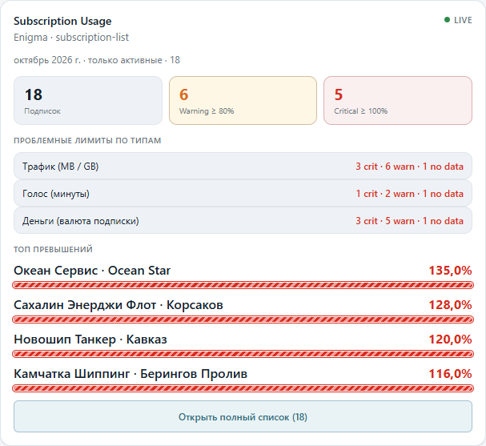
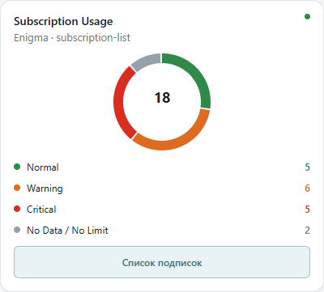
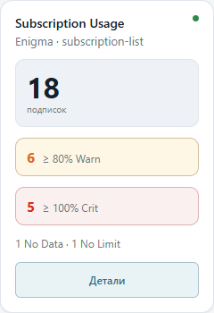

# Subscription Usage Widget — INTERA Task 1

Виджет мониторинга расхода лимитов телекоммуникационных подписок (источник Enigma `subscription-list`) для дашборд-платформы INTERA.

**Стек:** React 19, TypeScript 5, Vite 7, Vitest 4  
**Требования:** Node.js ≥ 20

---

## Установка и запуск

```bash
npm install
npm run dev
```

Откройте в браузере адрес, который выведет Vite (обычно `http://localhost:5173/`).

В песочнице можно переключать:

- размер карточки: `full` / `half` / `third` / `quarter`
- состояние данных: `ready` / `stale` / `refreshing` / `loading` / `empty` / `error`
- тему: `light` / `dark`
- параметры виджета в панели справа/снизу

### Другие команды

```bash
npm test           # unit-тесты (Vitest)
npm run typecheck  # проверка типов TypeScript
npm run build      # production-сборка
```

---

## Реализованная функциональность

Виджет `SubscriptionUsageWidget` показывает расход лимитов подписок (`data` / `voice` / `money`) с учётом доменных правил Enigma:

- фильтр только активных подписок (`onlyActive`);
- разрешение единицы трафика GB vs MB без двойного учёта;
- статусы лимита: `normal` / `warning` / `critical` / `no_data` / `no_limit`;
- сводка по статусам и по типам лимитов (счётчики подписок, без сложения валют/единиц);
- поиск по клиенту, судну, терминалу и продукту;
- сортировка по расходу или имени клиента;
- адаптация к 4 размерам карточки INTERA;
- состояния данных: скелетон, фоновое обновление без сброса UI, `FreshnessMark` при `stale`, ошибка, пустой результат.

### Параметры виджета (`params`)

| Параметр | Тип | По умолчанию | Описание |
| --- | --- | --- | --- |
| `description` | `string` | `'Subscription Usage'` | Заголовок (`description` или `title`) |
| `subtitle` | `string` | `''` | Подзаголовок |
| `size` | `'full' \| 'half' \| 'third' \| 'quarter'` | `'full'` | Ширина карточки |
| `period` | `string` | `'all'` | `'all'` или префикс `YYYY-MM` периода |
| `customerId` | `number \| 'all'` | `'all'` | Фильтр по клиенту |
| `technologyIds` | `number[]` | `[]` | Фильтр по технологиям (пусто = все) |
| `onlyActive` | `boolean` | `true` | Только `subscription_active === 1` |
| `limitTypes` | `('data' \| 'voice' \| 'money')[]` | все три | Учитываемые типы лимитов |
| `warningThreshold` | `number` | `80` | Порог warning, clamp `[1, 500]` |
| `criticalThreshold` | `number` | `100` | Порог critical; при `warning ≥ critical` сброс на `80/100` |
| `statusFilter` | статус \| `'all'` | `'all'` | Фильтр списка (summary считается до него) |
| `rowLimit` | `10 \| 25 \| 50 \| 100` | `10` | Лимит строк (`rowLimit` или `maxRows`) |
| `showSummary` | `boolean` | `true` | Показ сводки |
| `showDetails` | `boolean` | `true` | Раскрытие деталей подписки |
| `sortBy` | `'usage_desc' \| 'usage_asc' \| 'customer_name'` | `'usage_desc'` | Сортировка списка |

### Размеры карточки

| Размер | Что отображается |
| --- | --- |
| **full** | KPI, donut/легенда, поиск и фильтры, таблица с прогрессом и деталями |
| **half** | Компактные KPI, разбивка по типам лимитов, топ превышений, кнопка полного списка |
| **third** | Компактный donut, счётчики статусов, кнопка списка |
| **quarter** | KPI общего числа, бейджи Warning/Critical, кнопка «Детали» |

---

## Архитектура

Три слоя в `src/widget/` (без «протекания» React в расчёт):

1. **`subscription-usage-params.ts`** — безопасный разбор `params: Record<string, unknown>` → `ISubscriptionUsageConfig`.
2. **`subscription-usage-compute.ts`** — чистая функция `computeSubscriptionUsage(rows, config, runtimeFilter)` (без React/DOM).
3. **`subscription-usage.tsx` + `.css`** — представление: 4 layout’а, состояния данных, диалог полного списка.

Дополнительно используются готовые примитивы платформы INTERA из `src/platform/` (`toFiniteNumber`, `FreshnessMark`, `WidgetHeader`, тема `theme.css` и т.д.), фикстура `src/data/mock-subscriptions.json` и песочница `src/sandbox/`.

### Библиотеки

| Пакет | Назначение |
| --- | --- |
| `react` / `react-dom` | UI |
| `typescript` | Типизация |
| `vite` / `@vitejs/plugin-react` | Dev-сервер и сборка |
| `vitest` / `happy-dom` | Unit- и widget-тесты |

Внешних UI-библиотек и state-менеджеров нет — только стек из задания.

### Основные решения

- Доменные инварианты Enigma сосредоточены в `compute` и покрыты тестами (GB/MB, sentinel `-1`, `no_data`, приоритет статусов, стабильность `summary`).
- `summary` и scoped-набор считаются **до** `statusFilter` / поиска / `rowLimit`.
- Стили только на CSS-переменных темы INTERA — работают light и dark.
- Фоновое обновление (`loading && loaded`) не размонтирует виджет, чтобы не терять поиск и раскрытые детали.

---

## Скриншоты (4 размера)

### full



### half



### third



### quarter



---

## Известные ограничения

Обязательные требования ТЗ выполнены. Зафиксированные ограничения продукта:

- Подписи статусов в UI частично на английском (`Normal` / `Warning` / `Critical`), остальные подписи — на русском; полной i18n-локализации нет.
- Виджет работает на mock-данных песочницы; подключение к живому Enigma API не входит в объём задания.
- В half-размере топ превышений учитывает текущие UI-фильтры статуса/поиска (согласован с открываемым списком), а KPI остаются по полному scoped-набору.

Невыполненных обязательных требований ТЗ нет.
